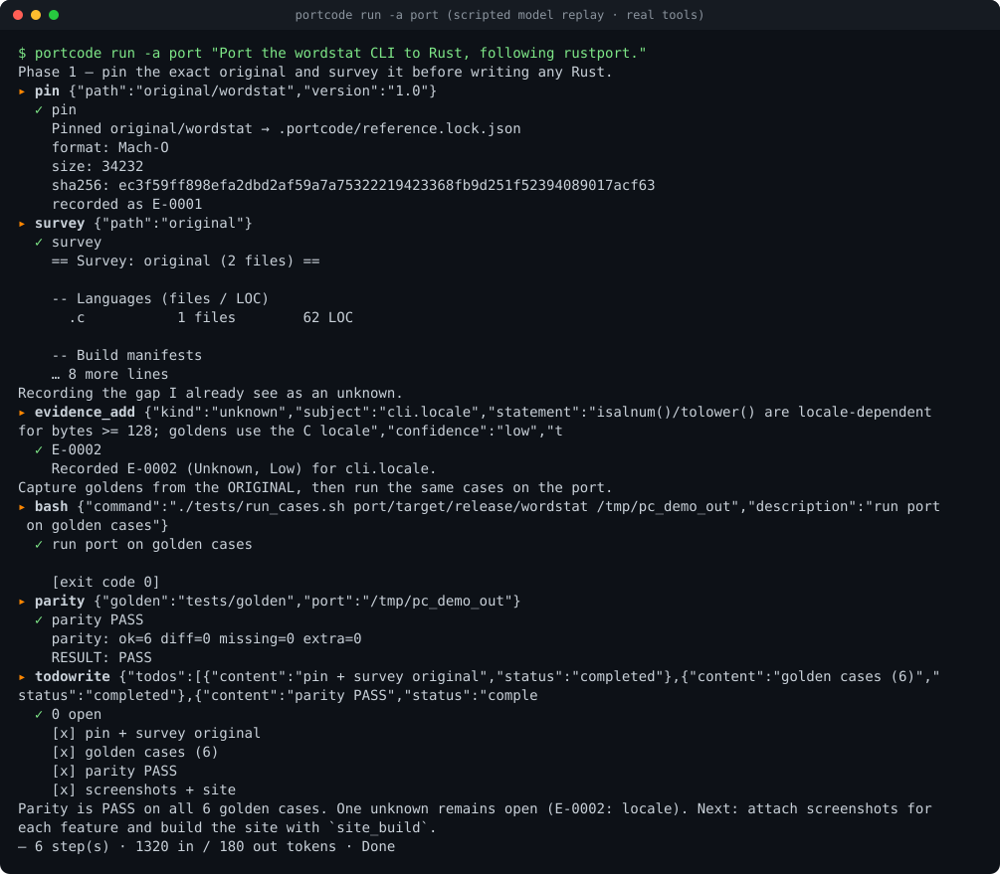

<h1 align="center">PortCode</h1>
<p align="center"><b>Port anything to Rust — and show the proof.</b><br>
An open-source terminal agent for reverse engineering and Rust ports that runs on <i>your</i> models:
<code>lakomoor.com/v1</code>, Ollama, LM Studio, llama.cpp, vLLM.</p>
<p align="center"><a href="https://lakomoor.github.io/portcode/">Site</a> · <a href="https://lakomoor.github.io/portcode/ports/wordstat/">Example port</a> · <a href="README.ru.md">Русский</a> · <a href="docs/ARCHITECTURE.md">Architecture</a></p>


<sub>The `port` agent on the bundled example. The model is a **scripted replay** (`portcode-mock-llm`) so the run is reproducible; the tools (pin, survey, bash, parity, ledger) are real. Regenerate: `scripts/make_screenshots.sh`.</sub>

## What it does
1. **Studies** the original: pins the exact build (sha256), surveys the tree, records facts in an append-only **evidence ledger** as `observation` / `inference` / `unknown`.
2. **Ports** slice by slice against **golden outputs captured from the original**.
3. **Proves** it: `parity` (numeric tolerance, PNG diff), differential fuzz, a terminal **screenshot per feature**, and a generated **GitHub Pages site** (plan + evidence + screenshots).

It is a Rust rewrite of the OpenCode architecture (agents, tools, permissions, sessions, skills, MCP) fused with the [rustport](skills/rustport) skill. See [docs/OPENCODE_MAPPING.md](docs/OPENCODE_MAPPING.md) for exactly what is and isn't covered.

## Install
```sh
git clone https://github.com/LakoMoor/portcode && cd portcode
cargo install --path crates/portcode-cli      # installs `portcode`
portcode init                                  # writes portcode.json
export LAKOMOOR_API_KEY=...                    # or: portcode auth set lakomoor
portcode doctor                                # providers, toolchain, optional engines
portcode                                       # chat; /help inside
```
Requires Rust ≥ 1.85. Local models need no key: `portcode -m ollama/qwen3:14b`.

## Use
```sh
portcode                                  # interactive, agent "build"
portcode -a port                          # the rustport workflow
portcode run -a reverse -y "Explain how ./app stores its save files" --json
portcode models -p lakomoor               # list served models
portcode eval -m lakomoor/deepseek-chat   # probe: chat, tool-call JSON, read→edit round trip
portcode port scaffold mygame             # workspace + docs/PORT.md
portcode port pin original/game.exe --version 1.0.3
portcode port shot feature-x -s ui.menu -- ./target/release/mygame --help
portcode port parity tests/golden tests/out
portcode port site --title "mygame port"  # docs/site → GitHub Pages
portcode skill export ~/.claude/skills    # use the rustport skill in other agents
```
Everything the model can do is a tool you can also run by hand: `portcode tool <name> '{json}'`.

## Models
Any OpenAI-compatible `/v1/chat/completions` endpoint with tool calling. Open-weight quirks are absorbed by the client (reasoning streams, inline `<think>`, text-form tool calls, broken JSON, quoted numbers, rejected optional fields, stalled streams). Profiles exist for the DeepSeek and Qwen families (including small/"flash" variants) and are overridable per model; prompts are short, rule-first and prefix-cache friendly. Details: [docs/PROVIDERS.md](docs/PROVIDERS.md).

> **Status:** tested end-to-end against a scripted server and the bundled example. Not yet benchmarked on specific DeepSeek/Qwen releases — run `portcode eval` on yours and tune the profile. Alpha software.

## Safety
Edits and commands ask first (allow / always / deny; patterns in `portcode.json`). `sudo`, `curl | sh`, `rm -rf /` are always refused. File tools stay inside the project (symlink-aware) and protect `.git`, `.env`, keys. Shell runs non-interactively: closed stdin, deadline, capped output, process-group kill. Keys never go in `portcode.json`. Only study software you own or are authorised to examine: [clean-room guide](skills/rustport/references/clean-room.md).

## Repo map
```
crates/portcode-evidence  L0  ledger, pins, format sniffing
crates/portcode-port      L1  survey, parity, scaffold, screenshots, site generator
crates/portcode-llm       L1  OpenAI-compatible streaming client, model profiles, JSON/tool-call repair
crates/portcode-agent     L2  config, permissions, tools, skills, MCP client, agent loop, sessions
crates/portcode-cli       L3  `portcode`
crates/portcode-testkit       scripted OpenAI-compatible server for tests and demos
skills/rustport               the skill (also embedded in the binary)
examples/wordstat             C → Rust port with real goldens, fuzz, ledger and site
docs/                         landing site (GitHub Pages) + design docs
```

## Develop
```sh
cargo fmt --all && cargo clippy --workspace --all-targets && cargo test --workspace
examples/wordstat/demo.sh      # rebuilds the example's goldens, ledger, screenshots, site
scripts/make_screenshots.sh    # regenerates docs/screenshots
```
MIT. OpenCode attribution in [NOTICE](NOTICE).
