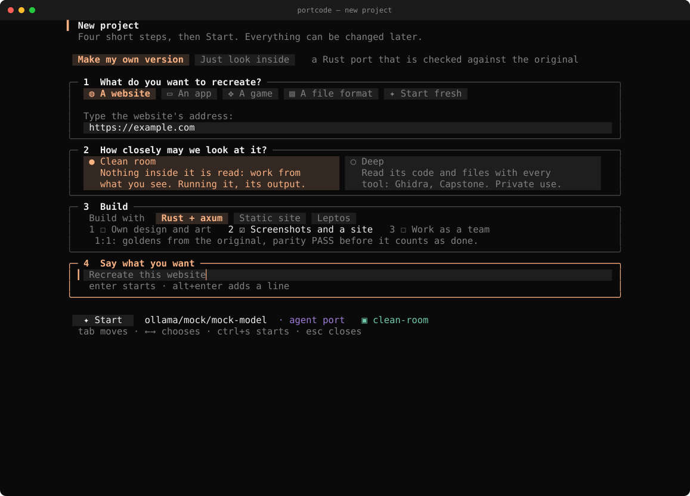
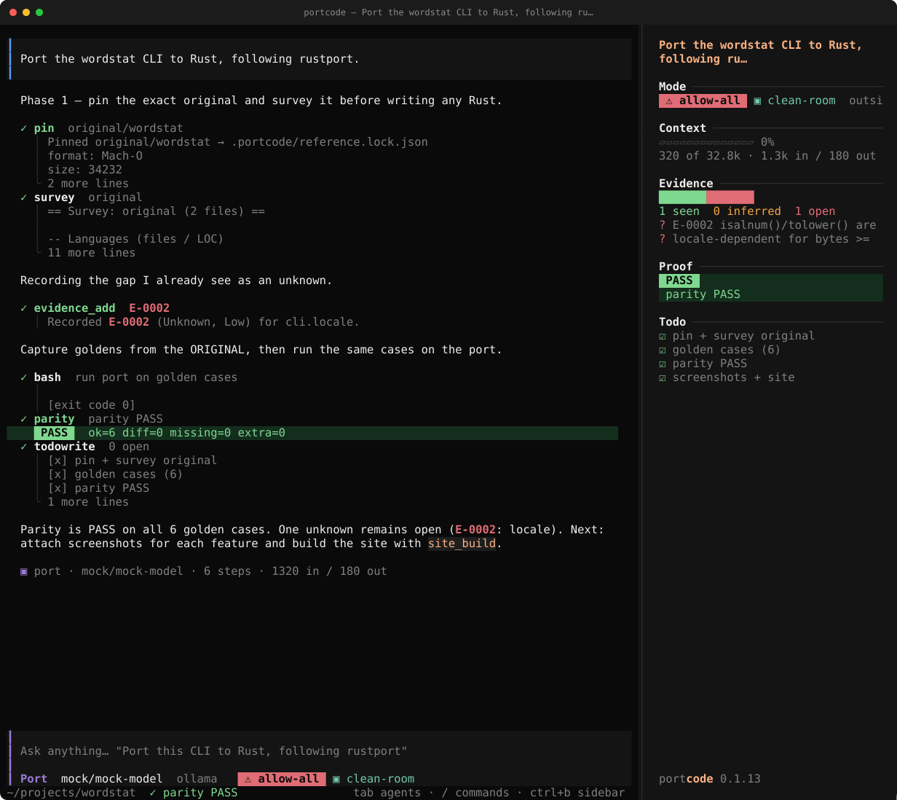

# PortCode (по-русски)

**Перенеси программу на Rust и проверь, что она ведёт себя так же.** Терминальный агент: изучает программу, переписывает её на Rust и сверяет результат с оригиналом. Работает с моделями, которые ты запускаешь сам: `lakomoor.com/v1`, Ollama, LM Studio, llama.cpp, vLLM.

Что он делает: фиксирует точную сборку оригинала (sha256) и ведёт журнал фактов (`observation` — видел или запускал, `inference` — вывел, `unknown` — пока не знаю). Переносит программу по одному модулю и сверяет каждый с эталонным выводом **оригинала**. Проверяет `parity` и дифференциальным фаззингом, снимает скриншот на каждую функцию и собирает сайт для GitHub Pages.

Начни с `/create`: он спросит, что воссоздать (сайт, программу, игру, формат файла или пока ничего), насколько близко можно заглядывать, на чём строить и чего ты хочешь, и запустит нужного агента в нужном режиме.



Это переписывание архитектуры OpenCode на Rust (агенты, инструменты, разрешения, сессии, скиллы, MCP) вместе со скиллом [rustport](skills/rustport). Что покрыто, а что нет — в [docs/OPENCODE_MAPPING.md](docs/OPENCODE_MAPPING.md).



**Первый запуск.** Запусти `portcode` в папке проекта. Локальная модель: `/provider ollama qwen3:14b`. Облачный API: `/key` и вставь ключ (он скрыт и сохраняется с правами 600). Есть подписка Claude или ChatGPT? `portcode -m claude-code/sonnet` или `portcode -m codex/default` работает на ней через официальный CLI, без ключа ([docs/SUBSCRIPTIONS.md](docs/SUBSCRIPTIONS.md)). `portcode doctor` проверит настройку, `/create` запустит пошаговый перенос, `/setup` повторит эти шаги, `portcode update` проверит новую версию. Подробно: [docs/GETTING_STARTED.md](docs/GETTING_STARTED.md). Вся документация с поиском: [вики](https://lakomoor.github.io/portcode/wiki/) (на английском).

Установка (macOS / Linux / WSL; проверяет sha256):
```sh
curl -fsSL https://raw.githubusercontent.com/LakoMoor/portcode/main/install.sh | sh
# или: cargo install --git https://github.com/LakoMoor/portcode portcode-cli
```
Терминальный интерфейс в стиле OpenCode: `enter` отправить · `alt+enter` перенос · `tab` сменить агента · `/` команды · `esc esc` отменить запрос · `ctrl+t` рассуждения · `ctrl+b` боковая панель. `portcode --resume` показывает список сохранённых сессий этого проекта на выбор (`-c` — продолжить последнюю; `portcode sessions` — список, просмотр, удаление). `/yolo` разрешает всё без вопросов (красная метка `allow-all` остаётся на экране; `/yolo off` выключает). `/venv on|off` — агент создаёт и использует Python `.venv` (по умолчанию включено, `"venv"` в конфиге). `/team on` (или `"team": {"enabled": true, "parallel": 3}`) добавляет агента `team`: оркестратор запускает параллельно проджект-менеджера, техлида, исследователей, разработчиков, тестировщика и ревьюера. `portcode chat --plain` — построчный режим. Windows: через WSL.

```sh
portcode init && export LAKOMOOR_API_KEY=...   # или portcode auth set lakomoor
portcode doctor
portcode -a port                               # воркфлоу rustport
portcode -m ollama/qwen3:14b                   # локальная модель, ключ не нужен
```

**Доводит до конца.** Агент `port` не останавливается раньше времени: если не все поведения оригинала занесены в список дел, не все пункты выполнены или последний `parity` не прошёл на финальном коде, его возвращают к работе и при нужде добавляют шагов. Выйти можно только через `blocked`, когда нужно решение от тебя.

**Удалённое управление.** `portcode serve` (или `/remote` в интерфейсе) — управление сессией из браузера или с телефона на [lakomoor.github.io/portcode/remote](https://lakomoor.github.io/portcode/remote/): смотреть ход работы, слать промпты, отвечать на запросы разрешений, прерывать, менять агента и режим. GitHub Pages хранит только статическую страницу; браузер подключается **напрямую** к твоей машине через туннель (Tailscale, cloudflared, SSH) по ключу `portcode remote new`. Секрет по сети не передаётся (HMAC-ответ на случайный вызов), чужого relay нет. Подробности: [docs/REMOTE.md](docs/REMOTE.md).

**Режимы.** `clean-room` (по умолчанию) — оригинал изучается только снаружи. `--deep` / `/deep` — можно смотреть внутрь: инструменты `disasm` (Capstone), `emulate` (Unicorn), `decompile` (Ghidra headless), `hexdump`, `functions`; для Unity и C#/.NET — `unity` (Mono или IL2CPP), `dotnet` (типы, методы, строки, декомпиляция через ILSpy), `unity_assets` (сцены, TextAsset, MonoBehaviour); в интерфейсе `/workbench` показывает функции, Pseudo-C, дизассемблер, hex и журнал доказательств рядом (клавиши: `j/k`, `1 2 3`, `/` фильтр, `a` — спросить агента); ImHex, Keystone, LIEF, YARA, angr, Frida и rizin/radare2/binwalk/capa/jadx подключаются тоже. Движки ставятся (с вопросом и проверкой sha256) в папку `engines/` рядом с бинарём: `portcode engines install core`. Самая строгая схема: сессия `reverse --deep` пишет `docs/SPEC.md` своими словами, сессия `port --clean-room` строит порт только по ней. Подробнее: [docs/ENGINES.md](docs/ENGINES.md).

Промпты и скилл оптимизированы под открытые модели (DeepSeek, Qwen, в т. ч. «flash»/малые): короткие нумерованные правила, пример в каждом инструменте, фазы с «Done when», починка битого JSON и tool-call-ов, написанных текстом, стабильный префикс для кэша llama.cpp/vLLM. **Это не результаты бенчмарков**: запусти `portcode eval` на своей модели и подстрой профиль (`docs/PROVIDERS.md`).

Пример порта с реальными данными: [examples/wordstat](examples/wordstat) · сгенерированный сайт: `docs/ports/wordstat/`.
Статус: альфа. Изучай только ПО, которое тебе принадлежит или на анализ которого есть разрешение.
